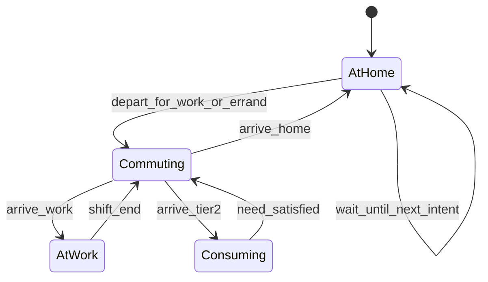
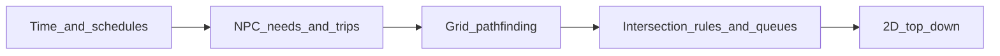

# Traffic grid transport game

## Status

draft

## Change type

docs-only

## Summary

A 2D top-down grid game built with Rust and Bevy where the player manages road networks and intersection controls (traffic lights, stop signs, roundabouts) while a minimal city generates realistic commute and shopping demand. NPCs live at home, work at tier-3 job sites or tier-2 work-plus-service sites, and maintain food, entertainment, and necessities need bars. Morning and evening rushes emerge from shared work hours (especially 9–5), with staggered schedules and jitter so peaks are strong but not perfectly synchronized.

## Motivation

Traffic and intersection design are the core creative and strategic loop. A full city-builder would dilute focus and scope. A thin demand layer (homes + jobs/services + simple schedules) is enough to stress the road system with believable rush-hour load without simulating zoning, economy, or urban growth.

## Detailed intent

### View and platform

- **Perspective:** top-down 2D on a discrete **grid**.
- **Stack (implementation phase):** Rust + Bevy ECS; rendering and UI in 2D.
- **Player fantasy:** traffic engineer / operator — fix congestion, tune signals, choose control types at intersections.

### Minimal city layer

| POI type | Purpose |
|----------|---------|
| **Living** | NPC residence; default location when idle or off-duty. |
| **Job tier 3** | Workplace only; trips are home ↔ job. |
| **Service tier 2** | Workplace for some NPCs **and** consumption destination for need fulfillment. |

**Tier 2 variants** (exactly three):

| Variant | Need bar |
|---------|----------|
| Food service | Food |
| Entertainment venue | Entertainment |
| Necessities retail | Necessities |

### NPC rules

- Each NPC has **one job** at a tier-3 or tier-2 site.
- Three **need bars** decay over time; when below a **comfort threshold**, NPC plans a consumption trip to the nearest appropriate tier-2 variant (subject to schedule).
- **Job obligation wins** over discretionary consumption when times conflict: must depart/arrive within work windows before optional shopping.
- **Consumption clustering:** lunch window and post-work leisure create secondary peaks; each NPC has small random offsets so histograms are smooth.

### Commute realism

- **Mass schedule:** majority of jobs use a classic ~09:00–17:00 pattern → **morning rush ~08:00–10:00**, **evening rush ~16:00–18:00** (in-game clock).
- **Staggered jobs:** configurable share of workplaces with shifted start/end (e.g. 06:00–14:00, 14:00–22:00) to spread demand.
- **Not all-or-nothing:** departure time = scheduled anchor + per-NPC jitter (minutes, not hours).

### Player / traffic layer (primary game)

Player interacts with **road network** and **traffic control**:

- Road tiles (direction, lanes where applicable).
- **Stop signs** — full stop + right-of-way rules.
- **Traffic lights** — phased signal timing (player-adjustable in scenarios).
- **Roundabouts** — yield-to-circulating traffic.
- Optional future: turn lanes, one-ways, speed limits (out of MVP unless listed in issues).

City POIs are **scenario content** or procedural seed — not the main build loop unless user overrides open question #1.

## Constraints

- **Rust + Bevy** for implementation; no alternate engine in scope.
- NPC AI stays **simple** (state machine + thresholds, no utility AI soup).
- Grid-based pathfinding; vehicles respect intersection controllers.
- Performance target (draft): **500–2000** concurrent travelers on a mid-size map at 60 FPS — tune during implementation; document in tech plan.
- Single-player; no netcode in initial vision.

## Open questions

| # | Question | Suggested MVP default (pending your confirmation) |
|---|----------|--------------------------------------------------|
| 1 | Player places homes/jobs or only roads and signals? | Scenario provides POI layout; player edits **network + traffic controls** only. |
| 2 | Real-time vs discrete ticks? | **Real-time** in-game clock with `pause` and `time_scale` (1×, 2×, 4×). |
| 3 | Movement presentation? | **Grid logic** for rules/pathing; **sprite interpolation** between tile centers for visuals. |
| 4 | Win condition? | **Scenario levels** with metrics (avg trip time, max queue length, rush delay); endless sandbox as secondary mode later. |
| 5 | Evening rush + consumption peaks in MVP? | **Documented now**; **morning rush + job commute** shipped first; evening and lunch peaks in phase 2. |

Please reply in chat to confirm or override defaults 1–5 before any GitHub gate 1.

## Risks and criticism

| Risk | Mitigation |
|------|------------|
| Intersection rules underspecified → rework | Annex D defines concrete precedence (document before coding signals/roundabouts). |
| Rush hour spikes melt CPU (pathing + queues) | Cap population per scenario; batch path requests; consider hierarchical routes later. |
| Tier-2 “same building, worker vs customer” confuses players | UI: distinct icons/overlays for employment vs visit intent; optional customer-only hours. |
| Scope creep into city-builder | Explicit out-of-scope list; gate features through traffic value (“does this affect congestion teaching?”). |
| 9–5 monoculture feels unrealistic | Staggered job table + jitter; document % in scenario JSON. |
| Bevy version churn | Pin Bevy version in first implementation issue; keep sim logic in crate modules testable without full engine where possible. |

## Out of scope

- Zoning, land value, taxes, detailed economy.
- Multiplayer / competitive leaderboards (initial).
- 3D camera or mesh roads.
- Pedestrians separate from vehicles (future consideration only).
- Weather, accidents, emergency vehicles (until core traffic loop is fun).
- Weekends / seasonal demand (MVP uses repeating weekday).
- Building placement as primary progression (unless open question #1 changes).

## Technical plan (draft)

### Crate / module separation (Bevy)

```text
crates/ or src/
  sim_time/     — clock, calendars, schedule tables
  agents/       — NPC needs, employment, trip intent
  pathing/      — grid A*, occupancy, reservations
  traffic/      — lanes, queues, intersection controllers
  world/        — grid map, POI definitions, scenario load
  game/         — Bevy plugins, input, camera, UI
```

### ECS sketch (illustrative)

| Entity flavor | Key components |
|---------------|----------------|
| Map tile | `GridPos`, `TileKind` (Road, Intersection, Building, Void) |
| Road segment | `LaneGraphEdge`, `SpeedLimit`, `Direction` |
| Intersection | `IntersectionId`, `Controller` (enum: Sign, Light, Roundabout) |
| NPC | `Home`, `Workplace`, `NeedBars`, `Schedule`, `AgentState` |
| Vehicle | `Route`, `Progress`, `WaitingAt` |

### Simulation order (fixed tick or real-time substep)

1. Advance **SimClock**.
2. **Schedule system:** emit departures (commute + consumption) from NPC state + jitter.
3. **Trip planning:** origin-destination → path on lane graph.
4. **Traffic system:** advance vehicles; intersection arbitration; accumulate delay metrics.
5. **Need decay / fulfill** when NPC is stationary at destination.
6. **Render / UI** (decoupled read-only snapshots where possible).

### Time model (default)

- 1 in-game day = **N real seconds** at 1× speed (e.g. 10–20 min real time — tune for fun).
- Work windows expressed in in-game minutes from midnight.

### Data-driven scenarios

- Scenario file: grid size, POI list, job schedule distribution, population count, victory thresholds.
- Keeps code generic; design iterates in data.

### Testing strategy (implementation)

- Unit tests: intersection right-of-way, signal phase transitions, roundabout yield.
- Integration: deterministic rush snapshot (fixed seed) compares total delay to golden range.

## Proposed issues (draft)

_Not GitHub issues until gate 1. Ordered coarse slices._

1. **Repo bootstrap** — Cargo workspace, Bevy pin, empty app with grid camera.
2. **Grid map + road tiles** — load scenario, render top-down tiles, basic lane connectivity.
3. **Sim clock + pause/speed** — in-game time UI.
4. **POI placement from scenario** — living, tier 3, tier 2 variants (data only).
5. **NPC needs + schedules** — decay, work windows, jittered departures.
6. **Trip generation** — home↔work and tier-2 consumption trips; priority rules.
7. **Grid pathfinding** — A* with dynamic edge cost from congestion (v1: constant weights).
8. **Vehicle movement** — follow route, queue at intersection entrance.
9. **Stop sign controller** — first-come-first-served or all-stop delay at 4-way.
10. **Traffic light controller** — 2-phase MVP, player edit cycle times in dev UI.
11. **Roundabout** — yield to circulating traffic, single-lane ring MVP.
12. **Rush metrics + scenario win** — morning rush KPIs, simple results screen.
13. **Phase 2: evening rush + lunch consumption peaks** — extend demand curves.
14. **Phase 2: sandbox mode** — no win condition, all metrics overlay.

## Design annexes

### Annex A — World model

**Coordinates:** integer grid `(x, y)`; screen Y-up or Y-down fixed per implementation (document in code README later).

**Tile kinds**

| Kind | Notes |
|------|-------|
| `Void` | Non-playable / border |
| `Building` | Living or POI footprint; may occupy 1×1 MVP |
| `Road` | Directed movement; connects to neighbors |
| `Intersection` | Special tile(s) hosting a `Controller` |

**POI types (logical)**

- `Living { id, grid_pos, capacity }`
- `JobTier3 { id, grid_pos, schedule_profile, slots }`
- `ServiceTier2 { id, grid_pos, variant: Food \| Entertainment \| Necessities, schedule_profile, worker_slots }`

**Road graph:** nodes at intersection centers (or tile centers); edges along road tiles with direction bitmask.

**MVP footprint:** 1×1 building tiles adjacent to road network; multi-tile buildings post-MVP.

### Annex B — NPC model

**State machine**



**Need bars**

| Bar | Decay | Filled at |
|-----|-------|-----------|
| Food | continuous per hour awake | tier 2 food |
| Entertainment | slower decay | tier 2 entertainment |
| Necessities | moderate decay | tier 2 necessities |

Parameters (draft for tuning): `comfort_threshold` ∈ (0, 1), `critical_threshold` < comfort, `fill_rate` while on-site, `decay_rate` global.

**Employment:** `workplace_id`, `work_schedule` (reference into schedule profile table).

**Trip priority (tie-break)**

1. Late for work departure window → commute to work.
2. Active work shift → remain at work (no mid-shift entertainment unless scenario allows — default **no**).
3. Critical need any bar → nearest tier 2 for lowest relative bar.
4. Pre-work discretionary if time until depart > buffer.
5. Post-work consumption then home.

**Vehicles:** MVP 1:1 NPC:vehicle when traveling; no rideshare.

### Annex C — Time and demand

**Schedule profiles (examples)**

| Profile ID | Work start | Work end | Share of jobs (example) |
|------------|------------|----------|-------------------------|
| `standard_9_5` | 09:00 | 17:00 | 70% |
| `early_shift` | 06:00 | 14:00 | 15% |
| `late_shift` | 14:00 | 22:00 | 15% |

**Departure rule for commute to work**

`depart_time = work_start - commute_buffer + jitter`

where `commute_buffer` ≈ 30–60 in-game minutes (scenario-tuned), `jitter` ∈ uniform `[-10, +15]` minutes unless overridden.

**Reference departure histogram (standard jobs only, illustrative)**

| Hour (in-game) | Relative departures |
|----------------|---------------------|
| 07 | Low |
| 08 | **High** |
| 09 | **Peak** |
| 10 | Medium |
| 11+ | Low for commute |

Evening mirror: departures from workplace cluster 16:30–18:00 with jitter.

**Consumption windows (phase 2 default timing)**

- Lunch: 11:30–13:30 food/necessities bump.
- Evening entertainment: 18:00–21:00.

**Demand metrics for design**

- Track **trips/hour** by purpose: `commute_work`, `commute_home`, `consume_*`.
- OD pairs: home → work, work → home, home → tier2 → home.

### Annex D — Traffic simulation (core product)

**Player tools**

- Paint/remove road (if scenario mode allows limited edits — else read-only roads in MVP).
- Place/replace intersection controller type.
- Edit signal phase durations and offsets (lights).

**Stop sign (4-way MVP)**

1. Vehicle enters intersection approach → joins FIFO queue per approach.
2. If all-way stop: full stop `T_stop` (e.g. 1 s game time); proceed in FIFO global order.
3. If 2-way stop: major road has priority; minor road yields.

**Traffic light (2-phase MVP)**

- Phase A: NS green, EW red.
- Phase B: EW green, NS red.
- Yellow all-red clearance optional in v1.1.
- Player sets `(green_ns, green_ew)` minimum.

**Roundabout (single-lane MVP)**

1. Entering traffic yields to vehicles already in ring.
2. Ring vehicles exit at desired leg; no lane changing inside ring.
3. Queue backs up on approach edges; congestion metric = max queue length / avg wait.

**Conflict points**

- Each intersection defines **movement permissions** (straight, left, right) per approach.
- MVP: no turn on red; no protected left (simplify to straight-only first if needed).

**Scoring (scenario mode)**

- `avg_commute_delay` during morning window ≤ threshold → pass.
- Fail if any approach queue exceeds `Q_max` for `T_fail` seconds.

### Annex E — Architecture (Bevy)



**Plugin layout (draft)**

| Plugin | Responsibility |
|--------|----------------|
| `SimTimePlugin` | `SimClock`, schedule events |
| `WorldPlugin` | load scenario, spatial index |
| `AgentPlugin` | needs, state machine, trip requests |
| `PathingPlugin` | routes, incremental replan on closure |
| `TrafficPlugin` | vehicles, controllers, metrics |
| `GameUiPlugin` | overlays, signal editor, time controls |

**Resources**

- `ScenarioConfig`, `TrafficMetrics`, `SimClock`, `Rng` (seeded).

**Events**

- `TripRequested { agent, from, to, purpose }`
- `VehicleArrived { vehicle, node }`

## Raw notes

- Brainstorm source: [`docs/brain-storming/2026-11-19-traffic-grid-city.md`](../brain-storming/2026-11-19-traffic-grid-city.md)
- User emphasis: “pretty much the end of the pnj mechanics” — invest in traffic depth after commute demand is believable.